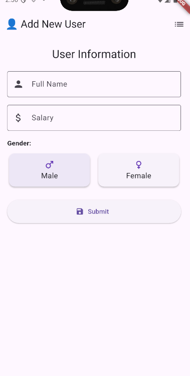
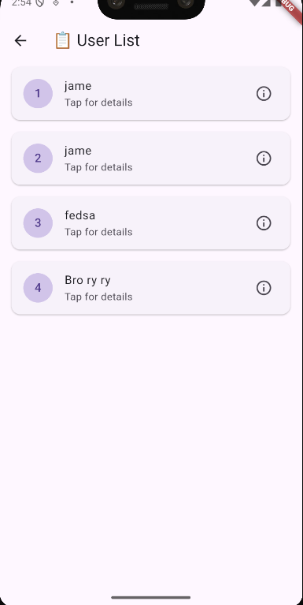
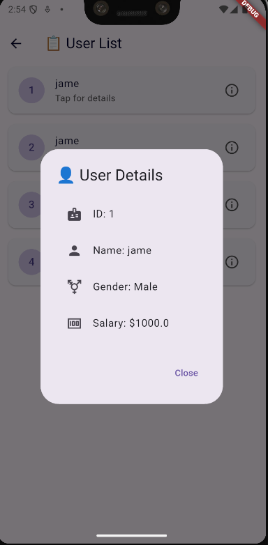

# 🧑‍💼 Flutter User Management App

A simple Flutter CRUD (Create, Read) app that uses **SQLite** to manage user data including **name**, **gender**, and **salary**. The app is built using **Material 3** design principles for a clean and modern user experience.

---

## 📱 Features

- Add users with:
  - Name
  - Gender (Male/Female)
  - Salary
- View all users in a scrollable list
- Tap on a user to view full details
- Uses local SQLite database for data storage
- Clean, responsive UI with Material You styling

---

## 🛠️ Tech Stack

| Technology | Usage                     |
|------------|---------------------------|
| Flutter    | UI & app framework         |
| Dart       | Programming language       |
| SQLite     | Local database             |
| sqflite    | SQLite plugin for Flutter  |
| path       | File path handling         |

---

## 📂 Project Structure

```
lib/
├── db.dart # SQLite database helper
├── main.dart # Entry point and user input form
└── detail_page.dart # User list and detail viewer
```

---


---

## 🚀 Getting Started

### 1. Clone the Repo

```bash
git clone https://github.com/yourusername/flutter-user-management-app.git
cd flutter-user-management-app
```

### 2. Set Up the Environment

Ensure you have Flutter installed. If not, follow the [official Flutter installation guide](https://flutter.dev/docs/get-started/install).

### 3. Run the App

```bash
flutter run
```


## 🤝 Contributing

Contributions are welcome! Please read the [CONTRIBUTING](CONTRIBUTING.md) guidelines before submitting a pull request.

---

## 📸 Screenshots

Add User Page	User List Page	User Detail Page
 
---

## 📦 Dependencies
```yaml
dependencies:
  flutter:
    sdk: flutter
  sqflite: ^2.3.0
  path: ^1.9.0
```

---

## 📝 License

This project is licensed under the PSU License - see the [Chhery Chorn](LICENSE) file for details.

---